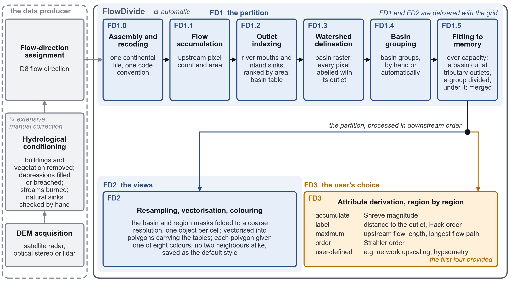
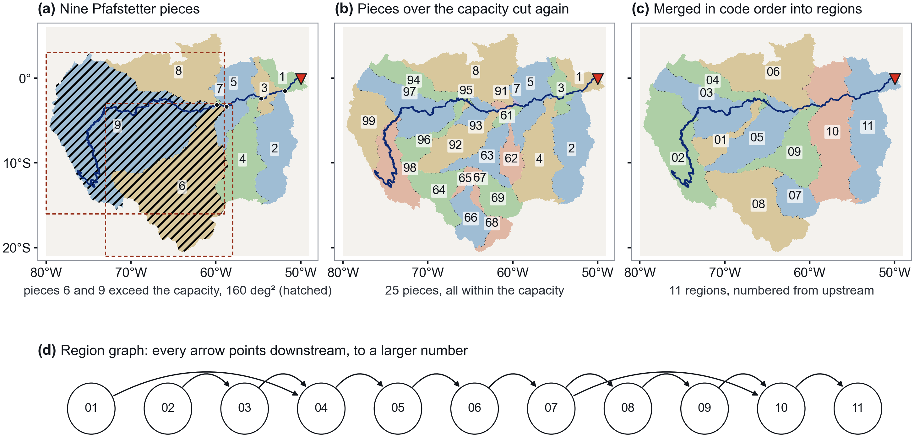

# FlowDivide

FlowDivide computes hydrographic attributes on D8 grids larger than memory by cutting them into connected regions.



*FD1 partitions the grid; FD2 makes views; FD3 computes attributes region by region.*



*The Amazon is cut and merged into 11 regions, numbered so every flow goes to a larger number.*

## Install

```sh
git clone https://github.com/hellolulujiang/flowdivide.git
cd flowdivide
conda create -n flowdivide -c conda-forge python=3.11 numpy numba rasterio gdal pandas geopandas pyogrio pyarrow shapely scipy matplotlib
conda activate flowdivide
```

## Run

Set the input paths as described in [Running](docs/user-guide.md#running), then:

```sh
python flowdivide.py run south-america --out-root out
python flowdivide.py run south-america --out-root out --steps fd3 --capacity 2^31
```

Each region fits the chosen capacity. One value crosses each cut; results match a whole-grid run pixel for pixel.

## Documentation

[User guide](docs/user-guide.md): inputs, options, outputs, memory, checks and custom attributes.

## Data products

FullDivide partitions: [HydroSHEDS v2.0, 30 m](https://fullhydro.org/downloads/hydrosheds-v2.0-30m/fullbasin/fulldivide/v1.0/) over North and South America; [MERIT Hydro, 90 m](https://fullhydro.org/downloads/merit-hydro-v1.0.1-90m/fullbasin/fulldivide/v1.1/) globally.

[Paper data](https://fullhydro.org/downloads/papers/flowdivide/v1.0/) · [FullHydro tools](https://fullhydro.org/tools/)

## Citing

Jiang, L., Chen, W. *FlowDivide: a standard workflow for hydrographic attributes from flow-direction grids that outgrow a computer's memory.* Submitted to *Environmental Modelling & Software*.

Cite this repository with the release used. [Paper figures and archive](docs/user-guide.md#paper-and-reproducibility).

## Licence

MIT; see [LICENSE](LICENSE). Input data retain their producers' terms; see [DATA_NOTICE.md](DATA_NOTICE.md).
